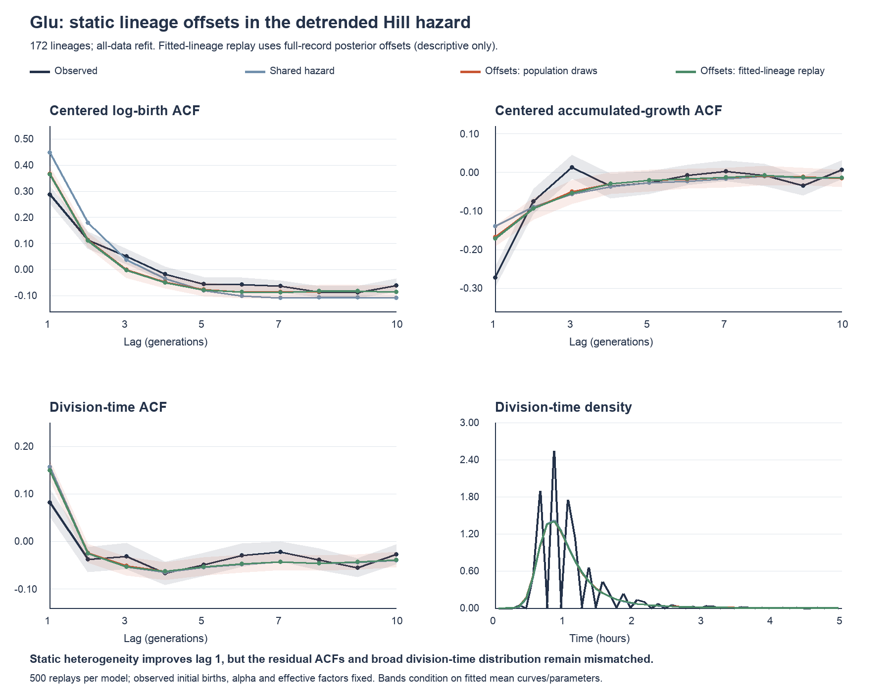

# Microbial growth and division

The current Glu model is a **four-parameter Hill timing hazard with one static
Gaussian lineage offset**, fitted after exact empirical detrending. It is our
current working model, not a complete explanation of the joint data: birth-size
statistics improve, but residual ACF and timing-distribution mismatches remain.
Earlier experiments are listed briefly below.

## Data and exact detrending

The common input is [processed_input_data.csv](data/processed/processed_input_data.csv).
All nine sugars and the original data are retained. The filtered Glu data contain
6,504 observations from 303 lineages; this analysis uses the balanced subset of
172 lineages with births at generations 0–20: 3,612 births and 3,440 transitions.

Write \(x_{\ell i}=\log b_{\ell i}\), \(g_{\ell i}=\alpha_{\ell i}t_{\ell i}\), and
define the outgoing effective division factor by

\[
q_{\ell i}=\log F_{\ell i}
=x_{\ell,i+1}-x_{\ell i}-g_{\ell i}.
\]

Thus the observed growth identity holds exactly. These effective factors absorb
the growth/endpoint residual; they are not the raw measured division fractions.
Raw fractions are attached to the daughter row, whereas \(F_{\ell i}\) here labels
the transition out of cycle \(i\).

With generation-wise empirical means \(m_i=\overline{x_i}\),
\(\nu_i=\overline{q_i}\), and \(\mu_i=\overline{g_i}\), define

\[
X_{\ell i}=x_{\ell i}-m_i,\quad B_{\ell i}=e^{X_{\ell i}},\quad
Q_{\ell i}=q_{\ell i}-\nu_i,\quad G_{\ell i}=g_{\ell i}-\mu_i.
\]

The balanced cohort gives the exact identities

\[
m_{i+1}-m_i=\nu_i+\mu_i,\qquad
X_{\ell,i+1}=X_{\ell i}+Q_{\ell i}+G_{\ell i}.
\]

This removes the empirical mean curve, not a linear approximation. We center the
product \(\alpha t\), not the individual factors. Validation uses means estimated
only from training lineages.

## Current model

The hazard per unit centered growth is

\[
\lambda_{\ell i}(G\mid B,a_\ell)
=\omega_2\,\operatorname{sigmoid}\!\left[
\eta\log\!\frac{B(e^{G+\mu_i}-1)}{u}
+\kappa\log B+a_\ell
\right],\qquad G>-\mu_i,
\]

\[
a_\ell\sim N(0,\tau_a^2),\qquad
f_{\ell i}(G\mid B,a_\ell)
=\lambda_{\ell i}(G\mid B,a_\ell)
\exp\!\left[-\int_{-\mu_i}^{G}\lambda_{\ell i}(s\mid B,a_\ell)\,ds\right].
\]

The same offset is used throughout a lineage. Equivalently,
\(u_\ell=u\exp(-a_\ell/\eta)\): this adds static threshold heterogeneity, not a
new dynamically evolving memory variable. There are five population parameters;
the empirical mean curves are additional fixed, data-estimated inputs.

The lower support limit matters: 54.1% of the centered growth increments are
nonpositive. Numerically, integration uses positive \(g=G+\mu_i\). Translation
alone has unit Jacobian and does not change the likelihood; replacing absolute
birth size by relative \(B\) is the substantive modeling change.

### Inference and fitted parameters

We maximize the marginal likelihood (empirical Bayes),

\[
L(\theta)=\prod_\ell\int
\phi(a;0,\tau_a^2)\prod_i f_{\ell i}(G_{\ell i}\mid B_{\ell i},a)\,da.
\]

One offset is integrated over the entire lineage likelihood, rather than
independently at each cycle. Numerical fitting uses multistart bounded BFGS,
analytic gradients, and checked hazard/offset quadrature. Population parameters
are point estimates, not full Bayesian posterior samples.

| Parameter | All-cohort estimate |
|---|---:|
| \(u\) | 0.59844 |
| \(\omega_2\) | 12.62583 |
| \(\eta\) | 9.15157 |
| \(\kappa\) | 3.55019 |
| \(\tau_a\) | 0.81841 |

The corresponding log-threshold SD is \(\tau_a/\eta=0.08943\), approximately
9% multiplicative threshold variation.

The fixed [workflow configuration](config/glu_current_workflow.json) records the
reused exploratory split: 134 training and 38 validation lineages in this cohort.
Relative to the shared four-parameter hazard:

- Held-out sequence gain: **+0.00396 nats/transition**, lineage-bootstrap
  95% interval \([-0.00890,0.01636]\).
- Last ten cycles conditional on the first ten: **+0.01091 nats/transition**,
  interval \([-0.00889,0.02972]\).

These intervals include zero: predictive improvement is not established. This
reused split is an exploratory check, not a fresh confirmatory test.

### Simulation checks

The retained checks use 500 conditional replays, fixing observed growth rates,
effective factors, and initial births. Later growth increments, times, and birth
sizes are generated. Data-derived mean curves stay fixed; simulations are not
recentered using their own means.

| Statistic | Observed | Shared hazard | Static offsets, population replay |
|---|---:|---:|---:|
| Centered log-birth ACF, lag 1 | 0.289 | 0.448 | 0.368 |
| Centered log-birth ACF, lag 3 | 0.050 | 0.039 | 0.001 |
| Centered growth ACF, lag 1 | −0.272 | −0.139 | −0.167 |
| Division-time ACF, lag 1 | 0.082 | 0.157 | 0.150 |
| Division-time SD | 0.625 | 0.492 | 0.499 |
| Birth-size SD | 0.446 | 0.493 | 0.471 |

Population replay draws one new offset per lineage from its fitted Gaussian.
Posterior-offset replay instead conditions on the full observed lineage and is
descriptive, not held-out prediction. Both are saved.

**Conclusion:** static offsets provide a compact partial improvement. They do
not resolve the short-lag ACF discrepancies or the too-narrow time distribution.
Because observed \(\alpha\) and effective \(F\) paths are supplied, these are
conditional simulations, not an autonomous generative model of all variables.
Prior offsets are assumed independent of the supplied paths and initial births.

## Reproduce the current analysis

From the repository root, with Python 3.10 or later:

~~~bash
python -m pip install -r projects/microbial-growth/requirements.txt
python projects/microbial-growth/scripts/fit_empirical_detrended_hazard.py
python projects/microbial-growth/scripts/fit_static_offset_detrended_hazard.py
python projects/microbial-growth/scripts/plot_empirical_detrended_hazard.py
python projects/microbial-growth/scripts/plot_static_offset_detrended_hazard.py
python -m unittest discover -s projects/microbial-growth/scripts -p 'test_*detrended*.py'
python -m unittest discover -s projects/microbial-growth/scripts -p 'test_glu_workflow.py'
~~~

Run the shared comparator first when rebuilding from scratch. It provides the
static-offset initialization and comparison. Random seeds and numerical settings
are explicit in the runners. The workflow configuration preserves validation IDs,
cohort expectations, and the processed-input checksum; no discarded experiment
output is needed by this workflow.

- [Current model implementation](src/static_offset_growth_hazard.py)
- [Current inference runner](scripts/fit_static_offset_detrended_hazard.py)
- [Shared-hazard comparator](scripts/fit_empirical_detrended_hazard.py)
- [Script guide](scripts/README.md) and [source guide](src/README.md)

## Retained results

- [Static-offset fit and checks](outputs/model_comparison/Glu/static_offset_detrended_hazard/):
  fit results, held-out scores, offset estimates, replay summaries, example
  trajectories, and figures.
- [Shared detrended hazard](outputs/model_comparison/Glu/empirical_detrended_hazard/):
  direct comparator, empirical mean curves, and detrended transitions.
- The nine sugars' loglogistic_endpoint_residual bundles and cross-sugar
  [summaries](outputs/summary/): historical reference analysis, **not** the current
  Glu model.
- Observed Glu ACF, drift/heterogeneity, persistence, and outlier diagnostics.

See the [output guide](outputs/README.md) and
[repository tree](docs/repository_tree.txt).

## Earlier attempts and diagnostics

These are superseded or diagnostic branches, rather than equally supported
alternatives. Their source remains available for provenance; their generated
Glu experiment outputs have been removed except for the explicit references above.

- Weibull/log-logistic adder–sizer and endpoint-residual models.
- Shared alpha-scaled Hill timing hazard.
- Hierarchical lineage-specific \(u\), \(\omega_2\), or both.
- Hierarchical lineage-specific \(u,\omega_2,\eta\).
- Likelihood-plus-ACF and lineage-specific ACF-only fitting.
- Deterministically decaying memory and total-elapsed-time modulation.
- Stationary leaky-memory and latent-setpoint models.
- Birth-dependent hazards with effective division factors.
- Alternative alpha clocks and parsimonious hazard screens.
- Conditional stochastic effective-division jumps.
- Empirical timing densities and Markov/factorization diagnostics.
- Joint growth/timing models and generated growth with independent factors.
- First- and second-order empirical birth-size transitions.
- Elapsed-time and cycle-specific empirical transition models.
- Mean-drift plus AR(1) birth-size models.
- Empirically detrended shared Hill hazard (retained comparator).
- Empirically detrended AR(1), with and without static offsets.

Historical scripts remain in place to preserve imports and research provenance.
Some require regenerating earlier experiment outputs before use; they are not
dependencies of the current workflow.

## Consolidation record

[cleanup_manifest.json](docs/cleanup_manifest.json) lists every removed output
folder/file and its recovery location. Original data and historical source were
preserved. Superseded outputs and prior documentation were moved to a local
temporary recovery directory outside the repository; this is **not a permanent
archive**. Retain that copy elsewhere if long-term recovery is required.

Check the original data's sharing permissions before publishing the repository.
